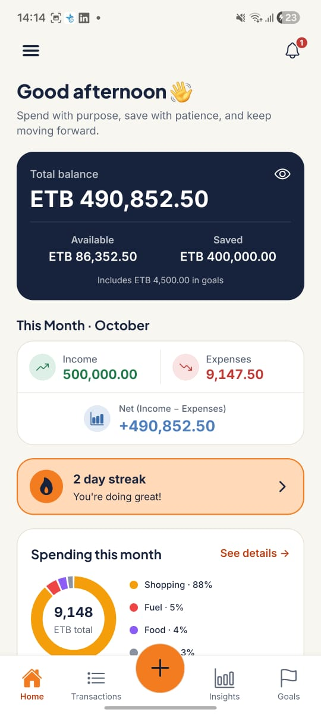
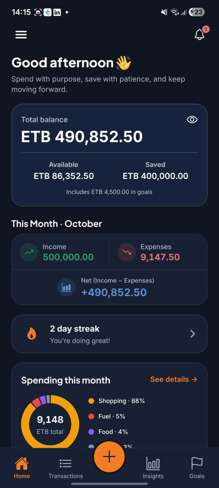
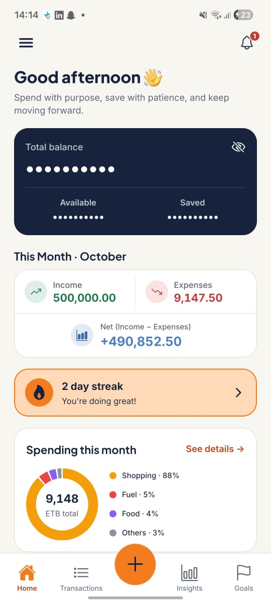
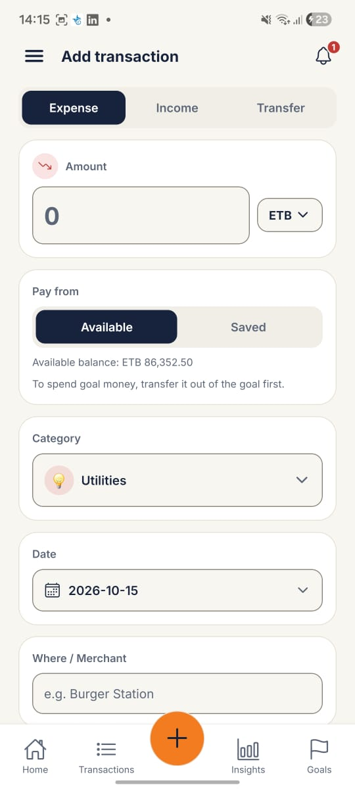
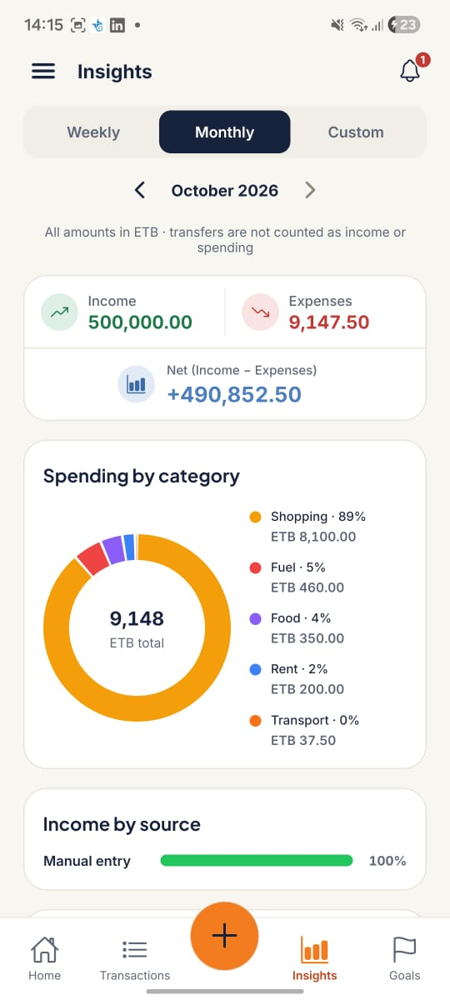
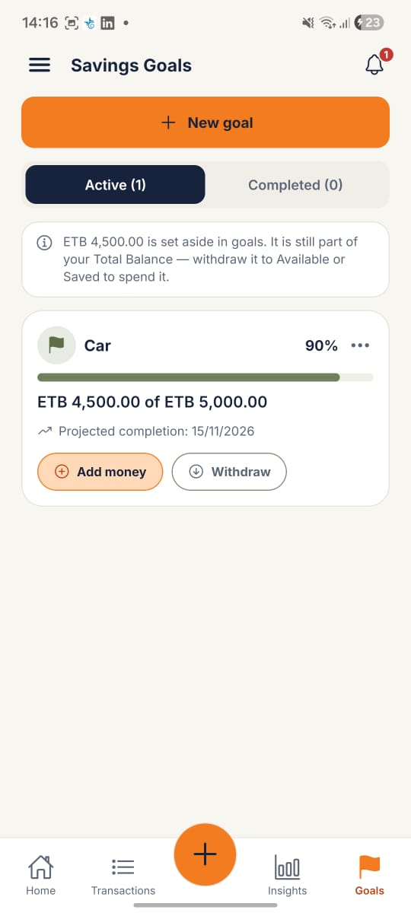

# Talari

Know where your money is. Control where it goes. Watch it grow.

Talari is a local-first personal finance app for Android (built with Expo and React Native). Your data stays on your phone: there is no sign-up and there are no servers, and the app makes no network requests of its own.

Built by Yonas Kiros with Claude Code as an AI pair-programming assistant.

## Features

- Accounts: the places your money actually is - Cash, wallets like Telebirr, banks - each in ETB or one foreign currency (a foreign account is valued at today's exchange rate). Your Total Balance is the sum of them. Names are unique, accounts can be archived, and Home's Cash / Wallet / Bank tiles open the Accounts screen.
- Transactions: income, expense and transfer between accounts (with an optional fee), with categories, merchants, notes and dates. Each one is recorded in an account.
- Ledger-derived balances: every balance (each account, the reserved goal money, the total) is calculated from the ledger rather than stored, so the numbers always add up.
- Goals: set money aside toward a target inside an account (it stays in the account, so the balance still matches your bank), add to it, withdraw from it, and see progress. If you spend reserved money the goal shrinks to match, and you are told.
- Budgets: monthly limits per category, with an alert in the in-app notification list at 80% of the limit and another when a budget goes over.
- Notifications: budget alerts and goal notifications ("reserved money was used") in one list with an unread badge; goal notifications are kept for 30 days.
- Recurring transactions: daily, weekly or monthly rules that post entries automatically.
- Multi-currency: your own list of currencies with manual exchange rates; every amount is converted to ETB for balances and reports.
- Insights: spending breakdown by category, income and expense totals, and a trend chart.
- Streaks and Journey: a daily tracking streak, monthly history and milestones.
- Import from SMS: paste messages from Telebirr, CBE, Bank of Abyssinia or Awash Bank and review them one by one before anything is saved. Nothing reads your inbox, the messages are read on the phone only and the text itself is never stored (only a hash, so a message is never suggested twice).
  - Review: the category is remembered per recipient, a payment's fee is saved as its own Fees expense, the amount, the charges and the total debited must agree (a fee is never counted twice), and "Save all that are clean" shows progress and a result that lists every message it left and why. A message that cannot be read can be copied with names and numbers hidden (best effort, never a promise of anonymity).
  - Dates: a printed date is used; a CBE message's date is read from its receipt reference; otherwise the paste date is used and marked as an estimate until you check it.
  - Transfers between your own accounts: two messages (or a message and an entry you typed) that are the two sides of one movement are offered as one transfer, never merged without your OK. They are found by the same transaction number, by one naming the other's bank, or by your own name as banks write it (a list you keep in Settings).
  - Balances: messages check each other's balances (a note when one seems to be missing, and Save asks first), an unprinted fee can be proposed from the balance, an account whose balance differs from the bank's newest message offers an adjustment (on a day you choose, with a note) and points at the likely gap, and an account's opening balance can be worked out from its oldest message, with a before-and-after preview.
  - Repair: entries saved by an earlier build with a fee counted twice are offered a one-time fix.
- Backup and export: a full JSON backup (accounts, transactions, goals, notifications, categories, budgets, exchange rates, which bank messages you have already handled - hashes and a few figures, never the messages - and your names as banks write them) you can restore, and a CSV export of your transactions. A backup holds your transactions with their names and notes, so keep the file private. Older backups still restore: those from before accounts existed go into one "Cash" account, and the app tells you how.
- App lock: unlock with the phone's biometrics or passcode.
- Appearance: Light, Dark or System (follows the phone).

## Tech stack

- Expo SDK 57 and React Native 0.86, with Expo Router for navigation
- TypeScript in strict mode
- SQLite (expo-sqlite) with Drizzle ORM
- Zustand for state
- React Native Reanimated and SVG for animation and charts
- Plus Jakarta Sans and Inter, embedded through the expo-font config plugin

## Running it

You need Node.js 22 or later, because one of the verify scripts uses Node's built-in SQLite module.

```bash
npm install
npx expo start
```

Open the project in Expo Go on your phone by scanning the QR code. Expo Go is enough for day-to-day development. Two things only show up in a real build: following the phone's Light/Dark setting (the `userInterfaceStyle` setting is applied when the app is built) and the embedded fonts (Expo Go loads them at runtime instead). Builds are made with EAS:

```bash
npx eas-cli@latest build --platform android --profile preview
```

## Checks

```bash
npx tsc --noEmit
npx expo lint
```

The verify scripts run the app's pure logic under Node (they use `npx tsx`, which is fetched on first use). The accounting script is written for East Africa Time; on macOS or Linux run it as `TZ=Africa/Addis_Ababa npx tsx scripts/verify-accounting.ts`:

```bash
npx tsx scripts/verify-accounting.ts      # Insights periods and trends, goal progress, streak, budgets, recurring, layout, schema 3 migration steps, notifications, search
npx tsx scripts/verify-splash.ts          # splash timeline
npx tsx scripts/verify-contrast.ts        # colour contrast of every text and graphic pair, Light and Dark
npx tsx scripts/verify-fonts.ts           # font weight to font family mapping
npx tsx scripts/verify-greeting.ts        # greeting, name rules and onboarding state
npx tsx scripts/verify-home.ts            # the rules behind the Home screen
npx tsx scripts/verify-budget-alerts.ts   # the 80% and over-budget alerts
npx tsx scripts/verify-appearance.ts      # Light / Dark / System resolution and the saved choice
npx tsx scripts/verify-accounts.ts        # accounts model: ledger, transfers and fees, reserved goal money, names, backup round trip and old-backup restore, notification retention, schema 3 to 4 migration
npx tsx scripts/verify-sms-parser.ts      # the SMS parser: number and date formats, every service template, ignored and unreadable messages, splitting a paste
npx tsx scripts/verify-sms-staging.ts     # SMS import: schema 5 migration, dedupe, recipient memory, review warnings and blocks, and the all-or-nothing save
npx tsx scripts/verify-sms-dates.ts       # SMS dates: the CBE receipt-date decoder, the order of date sources, printed times, the estimated-date label, schema 7 and backup
npx tsx scripts/verify-sms-pairing.ts     # SMS pairing: which messages are offered as one transfer, accepting and converting, dates, remembering "not a pair", schema 8 and the all-or-nothing save
npx tsx scripts/verify-sms-chain.ts       # SMS balance chain: order within a day, missing-message notes, fee proposals, times for saved entries, and the "balance doesn't match your bank" check
npx tsx scripts/verify-sms-bulk.ts        # Save all that are clean: the result lists every failure with its reason, progress, one screen update per batch, speed on a long history
npx tsx scripts/verify-sms-amounts.ts     # SMS amounts: amount, charges and total debited agree, a fee is never counted twice, earlier entries
npx tsx scripts/verify-sms-repair.ts      # the one-time "Fee counted twice" repair: which entries are offered, Fix and Fix all (all or nothing), restart safety
npx tsx scripts/verify-sms-opening.ts     # the opening balance from messages: derivation, which message is oldest, move back / replace with preview, refusals, all-or-nothing saves
npx tsx scripts/verify-sms-guidance.ts    # review and banner guidance: Move the opening back on a blocked card, likely gaps, Save asks when a message seems missing, adjustment day and note
npx tsx scripts/verify-backup-handled.ts # backup version 4: handled messages as hashes (never text), round trip, v3/v2 restore, damaged file refused, all-or-nothing, no duplicates after a restore
npx tsx scripts/verify-sms-hide.ts      # the hidden copy of an unreadable message: amounts, balances, dates kept; names, numbers, ids and links replaced with XXXX (best effort)
npx tsx scripts/verify-sms-ownnames.ts  # your names as banks write them and pairing rule 3: whole-name match, either side, ambiguity, schema 9, names in a backup
npx tsx scripts/verify-schema-mirror.ts # db/schema.ts (the Drizzle mirror) describes the same tables and columns as the real migrations
```

## Screenshots

| Home (Light) | Home (Dark) |
| :---: | :---: |
|  |  |
| Balances, this month's totals and recent transactions. | The same screen in the Dark theme. |

| Home with balances hidden | Add transaction |
| :---: | :---: |
|  |  |
| Balances are hidden until you tap the eye. | Record income, an expense or a transfer. |

| Insights | Goals |
| :---: | :---: |
|  |  |
| Spending by category, totals and trend. | Money set aside toward your targets. |

## Project notes

`V2_SPEC.md` is the specification the accounting model was built from, and the verify scripts check those rules. If something about how money is calculated is unclear, start there.

The database is built by the migrations in `db/` (schema 9 now; every step only adds). `db/schema.ts` is a Drizzle description of the result, and `scripts/verify-schema-mirror.ts` fails if it drifts from the migrations: the migrations are the truth.

`react-native-gesture-handler` is not a direct dependency. It is an optional peer of `expo-router`, so npm installs it unpinned (3.3.0 at the time of writing), while the SDK 57 version table names `~2.32.0`. `npx expo-doctor` does not check it because it is not in `package.json`, and nothing in the app's own code imports it. It is to be revisited with the SDK 58 upgrade; until then `package-lock.json` keeps it at 3.3.0, and `npx expo install --fix` can move it unasked, so check the lockfile diff after one.
